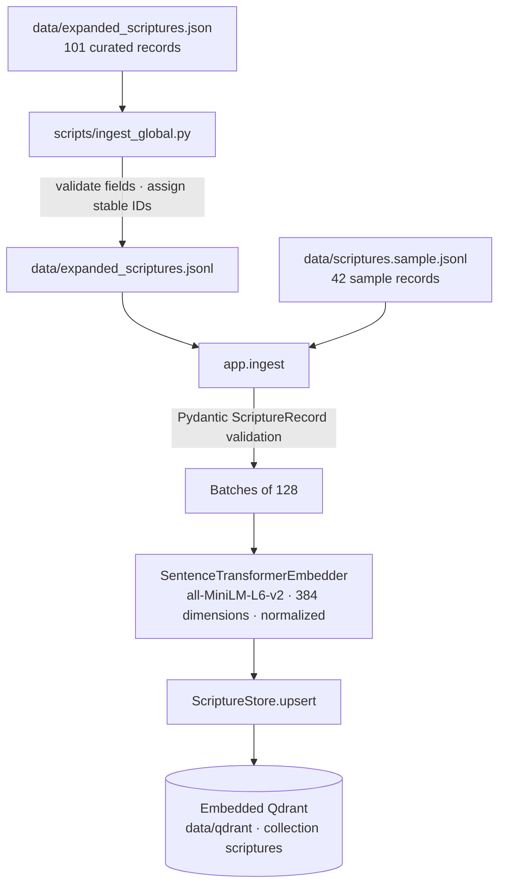

# Data Ingestion Pipeline

How curated scripture records become searchable vectors in SpiritRoute AI.

**Last verified:** 2026-10-27 · **Library:** 143 records (42 sample + 101 expanded) · **Collection:** `scriptures`

The pipeline is deliberately boring: it validates records, embeds text that is already verified, and upserts the result. It never generates scripture. That property is the foundation of the project's zero-hallucination guarantee.

---

## 1. Pipeline at a Glance



There are two entry paths into the same loader:

| Source | Command | Records |
| :--- | :--- | ---: |
| Christian sample | `python -m app.ingest data/scriptures.sample.jsonl` | 42 |
| Expanded multi-faith library | `python scripts/ingest_global.py` | 101 |
| Combined collection | Both commands, sample first | 143 |

`scripts/ingest_global.py` does not embed anything itself. It validates the human-edited JSON, writes a JSONL build artifact, and delegates to `app.ingest`, the shared loader used by both sources.

A separate startup path, `app/services/query_vectors.py`, embeds the 64 possible search sentences once when the API starts. That is query preparation, not data ingestion; it is described in section 7 only to keep the two embedding flows distinct.

---

## 2. Source Map

| File | Responsibility |
| :--- | :--- |
| `data/expanded_scriptures.json` | Human-edited source of truth for the 101 expanded records |
| `scripts/ingest_global.py` | Field validation, ID assignment/checking, JSON → JSONL conversion, delegation |
| `data/expanded_scriptures.jsonl` | Generated build artifact; one record per line; do not hand-edit |
| `data/scriptures.sample.jsonl` | 42-passage Christian sample, loaded by `app.ingest` directly |
| `app/ingest.py` | Record loading, 128-record batches, embedding, upsert, summary output |
| `app/schemas.py` | Enums, request/response models, `ScriptureRecord`, `embedding_text` |
| `app/services/embedding.py` | Model loading, dimension probe, normalized encoding |
| `app/services/vector_store.py` | Collection lifecycle, UUID point IDs, upsert, filtered search |
| `app/config.py` | Model name, embedding dimension, Qdrant path, collection name |
| `app/services/query_vectors.py` | Startup embedding of the 64 query sentences (separate from ingestion) |
| `data/qdrant/` | Generated embedded Qdrant store; never edit by hand |

---

## 3. Record Contract

A record in `data/expanded_scriptures.json` looks like this:

```json
{
  "belief_system": "Christianity",
  "source_book": "Matthew 6:31-32 (WEB)",
  "content": "Therefore don’t be anxious, saying, ‘What will we eat?’, ‘What will we drink?’ or, ‘With what will we be clothed?’ For the Gentiles seek after all these things; for your heavenly Father knows that you need all these things.",
  "themes": "worry about money and provision, anxiety about finances and bills, fear of not having enough for food and clothing, trust and faith, feeling provided for and safe, gratitude for what is given, contentment, abundance",
  "id": "christianity-matthew-6-31-32-web"
}
```

| Field | Required | Rule |
| :--- | :---: | :--- |
| `belief_system` | Yes | Non-empty string; exact hard-filter value, e.g. `Christianity`, `Islam`, `Atheist / Secular`, `Baha'i Faith` |
| `source_book` | Yes | Non-empty string shown to users; includes the translation, e.g. `Qur'an 65:7 (Pickthall)` |
| `content` | Yes | Non-empty, verbatim verified text; copied into the response unchanged |
| `themes` | No | Curated search metadata; embedded with the passage but never shown or sent to the LLM |
| `id` | No in JSON, required in Qdrant | Stable kebab-case identifier; generated from the belief system and source book if omitted |

`ingest_global.py` rejects missing fields, unknown fields, empty strings, and duplicate IDs before writing the JSONL. `app.ingest` then validates each line again through the Pydantic `ScriptureRecord` model, which also forbids extra fields and strips surrounding whitespace.

All 101 expanded records currently carry explicit IDs and non-empty themes.

### The embedded text

`ScriptureRecord.embedding_text` is what the model sees:

```python
@property
def embedding_text(self) -> str:
    return f"Themes: {self.themes}\n\n{self.content}" if self.themes else self.content
```

Themes come first. If a passage exceeds the model's 256-token limit, the truncation therefore hits the end of the passage rather than discarding the search metadata. The payload still contains both fields separately; `content` is what users receive.

### The zero-hallucination invariant

Ingestion copies `content`; it does not rewrite it. Before a record is added:

1. Verify the exact wording against the cited public-domain edition.
2. Confirm the translation's licence permits use.
3. Label SpiritRoute-authored material as `(original)` in `source_book`.
4. Never use a modern copyrighted rendering without permission.

`themes` may be authored for retrieval, but `content` must already be real.

---

## 4. Enum Modeling: `(str, Enum)`

The wizard's closed vocabularies are Python enums that mix in `str`:

```python
class Emotion(str, Enum):
    DEPRESSED = "Depressed"
    SAD = "Sad"
    HAPPY = "Happy"
    ANGRY = "Angry"

class Circle(str, Enum):
    FAMILY = "Family"
    FRIENDS = "Friends"
    CO_WORKERS = "Co-workers"
    FINANCES = "Finances"

class Driver(str, Enum):
    SAFETY = "Safety"
    WORTH = "Worth"
    AUTONOMY = "Autonomy"
    BELONGING = "Belonging"
    GRATITUDE = "Gratitude"
    CONNECTION = "Connection"
    PURPOSE = "Purpose"
    ABUNDANCE = "Abundance"
```

### Why mix in `str`

- Each member is both an enum member and a string. `isinstance(Circle.FINANCES, str)` is true, and `Circle.FINANCES == "Finances"` is true.
- Pydantic accepts the JSON string `"Finances"` and converts it to `Circle.FINANCES`; FastAPI publishes the allowed values in the OpenAPI schema.
- Responses serialize members as their values, so clients see `"Finances"`, not a Python object.
- Enum members are singletons, so internal comparisons can use identity: `drivers_for()` checks `emotion is Emotion.HAPPY`.

### The `.value` rule

Do not rely on an enum's string conversion when composing user-facing text. Python's enum formatting can produce the member path (for example `Emotion.HAPPY`) instead of the value. `app/diagnostic.py` therefore builds query sentences and validation messages with `.value`:

```python
return f"Feeling {emotion.value} about my {circle.value}, and wanting to grow in {driver.value}."
```

Pydantic serialization does the right thing automatically; hand-written string formatting does not necessarily.

### Validation layers

| Layer | What it accepts | Failure |
| :--- | :--- | :--- |
| FastAPI/Pydantic request model | `user_emotion`, `user_circle`, `user_driver` as enum values | `422` with the allowed values |
| Driver-to-emotion rule | Only the four drivers offered for that emotion | `422` from `driver_error()` |
| Belief-system match | Any non-empty string, filtered against loaded payloads | `404` if no passage matches |

`Driver` contains all eight values, so Pydantic alone would happily accept `Happy + Safety`. The enum is a vocabulary, not the pairing rule. `driver_error()` is the cross-field check, and `resolve_heart` raises `422` before retrieval.

`belief_system` is intentionally a plain `str`, not an enum. Adding a tradition is a data operation: ingest records and the value appears in `/api/v1/belief-systems`. Adding a circle or emotion, by contrast, is a code change because the wizard contract is closed.

### What the client receives

`GET /api/v1/diagnostic-options` serializes enum keys and values as strings:

```json
{
  "emotions": ["Depressed", "Sad", "Happy", "Angry"],
  "circles": ["Family", "Friends", "Co-workers", "Finances"],
  "drivers_by_emotion": {
    "Depressed": ["Safety", "Worth", "Autonomy", "Belonging"],
    "Sad": ["Safety", "Worth", "Autonomy", "Belonging"],
    "Happy": ["Gratitude", "Connection", "Purpose", "Abundance"],
    "Angry": ["Safety", "Worth", "Autonomy", "Belonging"]
  }
}
```

The frontend renders its buttons from this response. It does not hard-code circles, emotions, or driver lists.

---

## 5. How Finances Maps to the Psychological Drivers

The short answer: **Finances does not have its own driver map.** Finances is a Step 2 **Circle**, while Safety, Worth, Autonomy, and Belonging are Step 3 **Drivers**. In the code, the Step 1 emotion chooses which four drivers are offered; the circle never does.

So Finances combines with:

- **Safety, Worth, Autonomy, Belonging** when the emotion is Depressed, Sad, or Angry.
- **Gratitude, Connection, Purpose, Abundance** when the emotion is Happy.

That gives Finances **16 of the 64 valid answer combinations**: 4 emotions × 4 drivers. The four hardship drivers named in the request are exactly the set offered for the three hardship emotions.

| Step 1 emotion | Driver group | Drivers available with Finances |
| :--- | :--- | :--- |
| Depressed | Hardship | Safety, Worth, Autonomy, Belonging |
| Sad | Hardship | Safety, Worth, Autonomy, Belonging |
| Angry | Hardship | Safety, Worth, Autonomy, Belonging |
| Happy | Growth | Gratitude, Connection, Purpose, Abundance |

### What the hardship drivers mean in a money context

| Driver | User-facing description | Financially framed example |
| :--- | :--- | :--- |
| Safety | Feeling unsafe, unstable, or highly criticized | Unstable income, mounting bills, fear of not having enough |
| Worth | Feeling unvalued, taken for granted, or disrespected | Feeling like a failure because of money, or dismissed for earning less |
| Autonomy | Feeling controlled, trapped, or unable to choose | Debt, financial dependence, or a budget controlled by someone else |
| Belonging | Feeling excluded, isolated, or unloved | Exclusion from shared plans, or family expectations around money |

### The resulting query sentences

`build_search_query()` produces one sentence per answer:

```text
Depressed / Sad / Angry
Feeling {emotion} because of an issue with my {circle} involving a lack of {driver}.

Happy
Feeling Happy about my {circle}, and wanting to grow in {driver}.
```

For example:

```text
Feeling Angry because of an issue with my Finances involving a lack of Autonomy.
Feeling Happy about my Finances, and wanting to grow in Abundance.
```

`all_answers()` walks every emotion, every circle (including `Circle.FINANCES`), and the four drivers allowed for that emotion. The result is the 64 `(emotion, circle, driver)` tuples. `QueryVectors` embeds all 64 sentences at startup; a Finances answer is a dictionary lookup of one of its 16 vectors. There is no separate Finances vector and no Finances-specific retrieval path.

The library contains finance-focused passages with finance-language themes so these 16 answers have relevant material to retrieve. Themes should use the wizard's own vocabulary—money, finances, provision, wealth, spending, debt, generosity, poverty, abundance—only where the passage genuinely speaks to it.

---

## 6. Embedding and Batch Vectorization

### The model

| Setting | Default |
| :--- | :--- |
| `EMBEDDING_MODEL` | `sentence-transformers/all-MiniLM-L6-v2` |
| `EMBEDDING_DIM` | `384` |
| Vector distance | `COSINE` |
| Normalization | `normalize_embeddings=True` |
| Maximum input | 256 tokens |
| Device | CPU |

`SentenceTransformerEmbedder` loads the model, encodes a one-word dimension probe, and raises if the probe's length differs from `EMBEDDING_DIM`. That catches the common mistake of changing the model without updating the collection configuration. The first run downloads roughly 90 MB; later runs use the local Hugging Face cache.

Normalized vectors mean the dot product equals cosine similarity, matching the collection's configured distance.

### The batch loop

`app/ingest.py` sets:

```python
BATCH_SIZE = 128
```

It slices the validated records into chunks of 128, builds the text list from each record's `embedding_text`, and calls the embedder once per chunk:

```python
for start in range(0, len(records), BATCH_SIZE):
    batch = records[start : start + BATCH_SIZE]
    store.upsert(
        batch,
        embedder.embed_many([record.embedding_text for record in batch]),
    )
```

`sentence-transformers` then performs its own internal mini-batches while encoding; its default `batch_size` is 32. The 128 value controls how many records SpiritRoute validates and upserts per iteration, not the model's internal tensor batch.

With the current library:

- 101 expanded records fit in one 128-record loop iteration.
- 42 sample records also fit in one iteration, but they are a separate command and therefore a separate model load and upsert run.

Embedding is synchronous CPU work inside a CLI script. There is no async pipeline, queue, or external embedding API.

### Why themes are inside the embedded text

The model averages over the whole input. Themes give the search a compact description of the situations the passage answers, while the passage itself supplies the language of the source. Because themes are placed first, a long passage truncates only its own tail. Themes are never returned to users and never included in the LLM prompt.

---

## 7. Persisting into Embedded Qdrant

### Where the data goes

| Setting | Default |
| :--- | :--- |
| `QDRANT_URL` | Empty → embedded local mode |
| `QDRANT_PATH` | `<repo>/data/qdrant` |
| `QDRANT_COLLECTION` | `scriptures` |
| Vector size | 384 |
| Distance | Cosine |
| Point count | 143 |

The embedded store is **not a cluster**. It is a local, on-disk collection opened by one process. That makes local development simple and imposes the single-process constraint described below. Set `QDRANT_URL` to use a Qdrant server; the same `ScriptureStore` code then targets the remote collection.

### Collection lifecycle

`ScriptureStore.ensure_collection()` creates the collection when it is absent. If the collection exists, it checks the stored vector size against `EMBEDDING_DIM` and raises a `ValueError` advising `--recreate` when they differ.

Re-ingesting without `--recreate` is the normal path. The expanded loader never passes `--recreate`, so it never drops the collection.

### Point IDs and payload

Qdrant point IDs must be UUIDs or unsigned integers, while SpiritRoute uses readable string IDs. The store maps each record deterministically:

```python
uuid.uuid5(_ID_NAMESPACE, record.id)
```

The original ID remains in the payload. The payload contains:

```json
{
  "id": "christianity-matthew-6-31-32-web",
  "belief_system": "Christianity",
  "source_book": "Matthew 6:31-32 (WEB)",
  "content": "Therefore don’t be anxious, …",
  "themes": "worry about money and provision, …"
}
```

`content` and `source_book` are copied directly into the API response. `themes` stays in the payload for search only. `search()` returns a `ScriptureMatch` with `id`, `belief_system`, `source_book`, `content`, and `score`; themes are intentionally omitted.

### Upsert semantics

`ScriptureStore.upsert()` builds one `PointStruct` per record and calls Qdrant's upsert. The deterministic UUID makes the operation idempotent: re-running ingestion replaces the existing point instead of creating a duplicate. Duplicate human-readable IDs are rejected earlier, in both `ingest_global._load_records()` and `app.ingest.load_records()`.

Batches are independent. If a run fails after an earlier batch succeeded, those earlier points remain; re-running from the start is safe because upserts are idempotent. There is no cross-batch transaction.

### The single-process lock

Embedded Qdrant opens files under `data/qdrant` and allows one process at a time. The API and an ingestion run cannot both hold the store. **Stop Uvicorn before ingesting.** In a Qdrant server deployment this restriction disappears; `QDRANT_URL` makes the store remote.

### `--recreate`

`--recreate` deletes the collection before recreating it. Use it only when:

- the embedding model or its dimension changes;
- the collection configuration must be rebuilt.

It also erases every record, including the 42-record sample. A full rebuild is:

```bash
python -m app.ingest data/scriptures.sample.jsonl --recreate
python scripts/ingest_global.py
```

Do not run `--recreate` on the second command, and do not run it when a collection holds records you have not re-ingested.

### Payload indexes

For a remote Qdrant server, `ensure_collection()` creates a keyword payload index on `belief_system`. Embedded Qdrant ignores payload indexes, so the store skips the call in local mode. The belief filter is still applied inside every vector search, so a passage from another tradition cannot be returned.

---

## 8. Running the Pipeline

From the repository root, with the API stopped:

```bash
source .venv/bin/activate
pip install -r requirements.txt

# 1. Load the 42-passage sample (skip if it is already loaded)
python -m app.ingest data/scriptures.sample.jsonl

# 2. Validate, convert, embed and load the 101 expanded records
python scripts/ingest_global.py
```

Expected output of the expanded step on a store that already contains the sample:

```text
Wrote 101 records to data/expanded_scriptures.jsonl
Loaded 101 records (101 with themes). The collection now holds 143.
  Atheist / Secular: 17
  Baha'i Faith: 15
  Buddhism: 14
  Christianity: 1
  Hinduism: 14
  Islam: 18
  Jainism: 11
  Zoroastrianism: 11
```

(`app.ingest` reports the records in the file being loaded; the collection total includes the sample.)

Start the API only after ingestion completes:

```bash
uvicorn app.main:app --reload
```

### Adding a record

1. Verify the exact text and translation licence.
2. Append the record to `data/expanded_scriptures.json` with a unique ID and honest themes.
3. Stop the API.
4. Run `python scripts/ingest_global.py`.
5. Restart the API and verify the new passage is retrievable.

The script regenerates `data/expanded_scriptures.jsonl`; do not edit that file directly.

### Rebuilding the whole collection

```bash
python -m app.ingest data/scriptures.sample.jsonl --recreate
python scripts/ingest_global.py
```

This is the only supported way to combine `--recreate` with the two-source library. Using `--recreate` on the expanded step alone works only if the sample is no longer needed.

---

## 9. Verification

```bash
curl -s http://127.0.0.1:8000/health
```

Expected shape:

```json
{"status":"ok","scriptures":143,"llm_enabled":true}
```

```bash
curl -s http://127.0.0.1:8000/api/v1/belief-systems
curl -s http://127.0.0.1:8000/api/v1/diagnostic-options
```

The first should list all eight loaded traditions. The second should include `Finances` and the correct driver lists per emotion.

A Finances round trip:

```bash
curl -s http://127.0.0.1:8000/api/v1/resolve-heart \
  -H 'Content-Type: application/json' \
  -d '{
    "belief_system": "Buddhism",
    "user_emotion": "Happy",
    "user_circle": "Finances",
    "user_driver": "Abundance"
  }'
```

The returned `scripture_text` and `source` must come from the stored payload, never from the commentary model.

---

## 10. Failure Modes and Invariants

| Symptom | Meaning | Remedy |
| :--- | :--- | :--- |
| `item N has missing=['content']` | The JSON record lacks a required field | Add the field; do not leave it blank |
| `item N has missing=[] extra=['theme']` | A typo created an unknown field | Use `themes`; unknown keys are forbidden |
| `item N reuses id ...` | Duplicate stable ID | Give each record a unique ID |
| `Collection 'scriptures' stores X-dim vectors but EMBEDDING_DIM is 384` | Model/dimension changed without rebuilding | Re-ingest with `--recreate` and reload every source |
| Store cannot open / lock error | Another process, usually Uvicorn, holds embedded Qdrant | Stop the API and re-run |
| New record missing after ingestion | API was serving an older process, or the wrong collection path was used | Restart the API; check `QDRANT_PATH` |
| Long passage seems under-weighted | MiniLM truncates at 256 tokens | Keep themes first; shorten or split the passage |
| Model download stalls | First run needs Hugging Face network access | Pre-cache the model; set `HF_HUB_OFFLINE=1` afterward |
| `422` on a driver | The driver is not in the selected emotion's group | Use Safety/Worth/Autonomy/Belonging for hardship emotions; Gratitude/Connection/Purpose/Abundance for Happy |
| `422` on an emotion or circle | The value is not an enum member | Use the exact `/diagnostic-options` values |
| `404 No matching scripture found` | The belief system has no loaded records | Ingest records for that tradition or choose another |

### Invariants worth preserving

1. `content` is copied verbatim; ingestion is not a place for paraphrasing.
2. Every record has a stable ID; re-running is an upsert, not a duplicate insert.
3. `themes` may guide retrieval but must never be shown to users or sent to the commentary model.
4. The belief-system filter runs inside the vector query.
5. One process owns the embedded store.
6. `--recreate` is a deliberate, destructive operation.
7. Finances is a circle; drivers are chosen by emotion, not by circle.

---

## 11. Quick Reference

| Concept | Value |
| :--- | :--- |
| Expanded source | `data/expanded_scriptures.json` (101 records) |
| Sample source | `data/scriptures.sample.jsonl` (42 records) |
| Generated JSONL | `data/expanded_scriptures.jsonl` |
| Loader | `app/ingest.py` |
| Converter | `scripts/ingest_global.py` |
| Embedding model | `sentence-transformers/all-MiniLM-L6-v2` |
| Embedding dimension | 384 |
| Normalization | Enabled |
| Model input limit | 256 tokens |
| Ingestion batch size | 128 records |
| Internal encode batch | 32 (sentence-transformers default) |
| Vector distance | Cosine |
| Embedded store | `data/qdrant/` |
| Collection | `scriptures` |
| Point ID | UUID5 derived from the record ID |
| Belief filter | Applied inside the Qdrant query |
| Retrieval limit | 1 passage |
| Current total | 143 records |
| Finances combinations | 16 of 64 (4 emotions × 4 drivers) |
