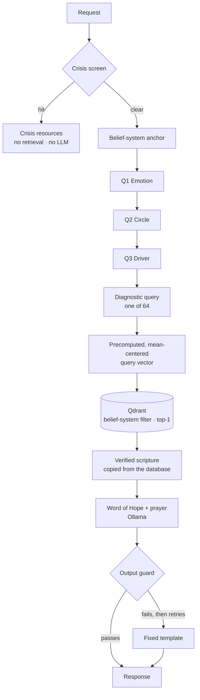
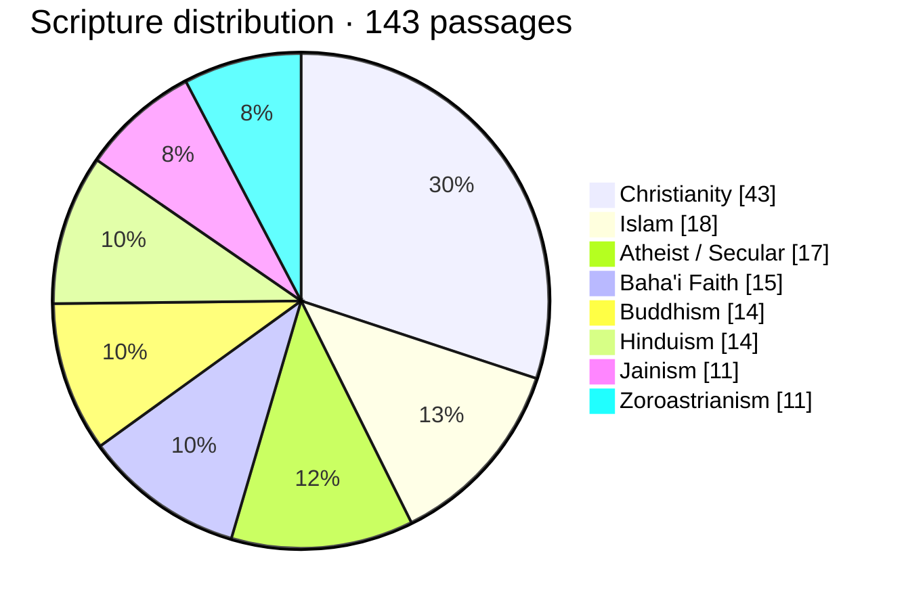
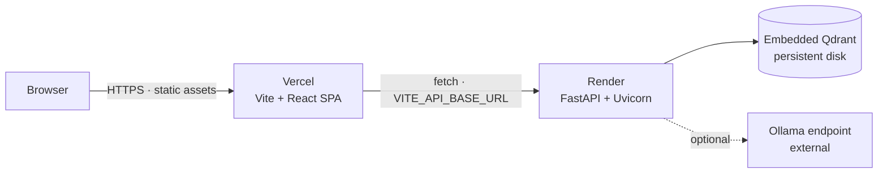

# SpiritRoute AI

> **Name the feeling. Find the need. Receive a verified word of hope.**

SpiritRoute AI is a private, multi-faith scripture companion. A person chooses their tradition, answers three short questions about an emotion, a relationship, and the need underneath it, and receives **one verified passage**, a short Word of Hope, and a prayer or reflection.

The scripture is always retrieved from a curated library and copied verbatim. It is never generated. A small local LLM writes only the commentary, and a fixed template takes over if the model fails the output guard.

`FastAPI` · `Qdrant Embedded` · `sentence-transformers` · `Ollama` · `React 19` · `TypeScript` · `Vite`

---

## Contents

1. [Project Vision](#1-project-vision)
2. [The 3-Question Root Cause Architecture](#2-the-3-question-root-cause-architecture)
3. [Technical Stack](#3-technical-stack)
4. [Multi-Faith & Secular Data Distribution](#4-multi-faith--secular-data-distribution)
5. [Split-Hosting Deployment Topology](#5-split-hosting-deployment-topology-vercel--render)
6. [Local Installation](#6-local-installation)

Reference: [API](#api-reference) · [Safety & operations](#safety--operational-notes) · [Tests](#tests) · [Layout](#layout)

---

## 1. Project Vision

Most spiritual apps either generate everything or retrieve everything. Generation risks inventing scripture. Retrieval alone can surface a passage that is beautiful but irrelevant to the person in front of it.

SpiritRoute takes the middle path:

- **Retrieval decides the scripture.** The passage and its citation are read directly from the database row returned by the search.
- **A light LLM writes only the bridge.** The Word of Hope and prayer are generated around the verified passage, then checked for accuracy and length.
- **The person's own tradition is a hard filter.** A Christian never receives a Qur'anic verse because it happened to score well.
- **Nothing personal is stored.** Answers are used for one lookup and then discarded. Responses are marked `Cache-Control: no-store`.
- **Crisis comes first.** Self-harm language triggers a resource screen before retrieval or generation.

### Design principles

| Principle | How it is enforced |
| :--- | :--- |
| Zero scripture hallucination | `scripture_text` and `source` are copied from the database, never from the model |
| Faith integrity | The belief-system filter runs inside the Qdrant query, not after it |
| Privacy by design | No conversation storage, no answer logging, no-store response headers |
| Low cost and local operation | CPU embeddings, embedded Qdrant, optional local 3B model via Ollama |
| Broad representation | Eight belief systems, including an Atheist/Secular track |
| Crisis-aware | The safety override is checked before the driver validation, retrieval, or LLM call |

### What a person receives

| Outcome | Payload |
| :--- | :--- |
| Normal answer | One verified scripture, its source, a Word of Hope, and a prayer/reflection |
| Crisis override | A short message and crisis resources, with no retrieval or generation |
| No match | A `404`; the UI invites the person to try a different answer |

SpiritRoute is a reflection tool, not therapy, a diagnosis, or an emergency service. See [Safety & operational notes](#safety--operational-notes) before deploying.

---

## 2. The 3-Question Root Cause Architecture

The product's "root cause" model is a structured brief, not a clinical diagnosis:

1. **Emotion** — what is being felt right now.
2. **Circle** — where the tension lives.
3. **Driver** — the need or strength underneath the feeling.

Before these three questions, the person selects a **belief system** (the "spiritual anchor"). That choice is not counted among the three questions; it becomes the hard retrieval filter.

| Step | Input | Options | Purpose |
| :--- | :--- | :--- | :--- |
| Anchor | `belief_system` | 8 traditions, loaded dynamically | Restricts retrieval to one library |
| Q1 | `user_emotion` | Depressed, Sad, Happy, Angry | Names the surface state |
| Q2 | `user_circle` | Family, Friends, Co-workers, Finances | Locates the relational context |
| Q3 | `user_driver` | 4 options determined by Q1 | Names the unmet need or existing strength |

### Driver groups

| Emotion group | Drivers | Orientation |
| :--- | :--- | :--- |
| Depressed / Sad / Angry | Safety, Worth, Autonomy, Belonging | Hardship: what feels missing or threatened |
| Happy | Gratitude, Connection, Purpose, Abundance | Growth: what the person wants to deepen |

Four emotions × four circles × four drivers gives **64 valid answer combinations**. The API rejects a driver from the wrong group with `422`.

### Request flow



### Query construction

The embedded search sentence is deterministic:

```text
Depressed / Sad / Angry
Feeling {emotion} because of an issue with my {circle} involving a lack of {driver}.

Happy
Feeling Happy about my {circle}, and wanting to grow in {driver}.
```

Happy cannot use the hardship template: its drivers are strengths, and "a lack of Gratitude" would retrieve passages about ingratitude for someone who is joyful.

### Why 64 precomputed vectors

All 64 query sentences are embedded once at startup. The mean vector is subtracted from each (query centering, enabled by default) so shared wording such as "Feeling … because of an issue with my …" does not pull every answer toward the same handful of passages. No request runs the embedding model. Set `QUERY_CENTERING=false` to search with the raw vectors.

### From search result to response

1. Qdrant returns the single closest passage **within the chosen belief system**.
2. The API copies `source` and `scripture_text` from the stored payload.
3. Ollama writes `word_of_hope` and `prayer_reflection` in a constrained JSON shape.
4. The output guard rejects commentary that cites another verse, quotes four or more words absent from the verified passage, or exceeds 150 words. A rejection is retried, then replaced by the built-in template.
5. The response is returned with `Cache-Control: no-store`.

---

## 3. Technical Stack

| Layer | Technology | Role |
| :--- | :--- | :--- |
| Frontend | React 19, TypeScript, Vite 8 | Server-driven five-screen wizard, plain CSS, no UI framework |
| API | FastAPI, Uvicorn, Pydantic v2 | Typed request/response models, validation, CORS |
| Vector store | Qdrant Embedded (`qdrant-client`) | On-disk cosine search with a belief-system filter |
| Embeddings | `sentence-transformers/all-MiniLM-L6-v2` | 384-dimensional CPU embeddings |
| Search tuning | Query centering + 64 precomputed vectors | Distinguishes answers and removes startup embedding cost |
| LLM | Ollama, `llama3.2:3b` | Writes only the Word of Hope and prayer; structured output |
| Safety | Crisis override + output guard | Resources before retrieval; commentary checked against scripture |
| Data | JSON / JSONL + ingestion scripts | Verbatim passages, curated themes, stable IDs |
| Tests | pytest | In-memory Qdrant, fake embedder, scripted LLM; no network needed |

### Backend anatomy

```text
app/
  main.py            app factory, CORS, Cache-Control
  routes.py          resolve-heart + wizard helper endpoints
  schemas.py         enums and request/response models
  diagnostic.py      driver rules, 64 combinations, query templates
  dependencies.py    service container built at startup
  ingest.py          embed and load JSONL records
  services/          embedding, query vectors, vector store, safety, LLM, guard, reflection
  prompts/           system prompt for the commentary model
```

### Frontend anatomy

```text
frontend/src/
  App.tsx            wizard state machine and API orchestration
  api.ts             typed API client and error handling
  constants.ts       human-readable driver descriptions
  components/        Belief, Emotion, Circle, Driver, Result screens
  styles.css         responsive 2×2 choice grid and screen styling
```

The wizard reads its labels from `/api/v1/diagnostic-options` and `/api/v1/belief-systems`, so adding a circle, emotion, or tradition does not require a matching frontend component.

### Privacy and cost profile

- No database of users, sessions, or submitted answers.
- `free_text` is screened for self-harm language and then discarded; it is never searched, prompted, or echoed.
- Access logs contain method, path, and status only.
- Embeddings run on CPU; the commentary model is a local 3B model or the fixed template.
- Embedded Qdrant requires no separate database service.

---

## 4. Multi-Faith & Secular Data Distribution

**143 verified passages** are loaded across **8 belief systems**: 42 sample passages in `data/scriptures.sample.jsonl` and 101 expanded passages in `data/expanded_scriptures.json`. Run `/health` for the live count.



| Tradition | Passages | Share | Primary public-domain sources |
| :--- | ---: | ---: | :--- |
| Christianity | 43 | 30.1% | World English Bible (WEB): 42 sample + 1 expanded |
| Islam | 18 | 12.6% | Pickthall |
| Atheist / Secular | 17 | 11.9% | Epictetus and Marcus Aurelius (Long), Seneca (Gummere), plus 6 SpiritRoute-written reflections labelled `(original)` |
| Baha'i Faith | 15 | 10.5% | The Hidden Words (Shoghi Effendi) |
| Buddhism | 14 | 9.8% | Dhammapada (Müller, SBE 10) |
| Hinduism | 14 | 9.8% | Bhagavad Gita (Arnold, Besant) |
| Jainism | 11 | 7.7% | Acharanga and Uttaradhyayana Sutras (Jacobi, SBE 22/45), Tattvartha Sutra (S.A. Jain) |
| Zoroastrianism | 11 | 7.7% | Yasna and prayers (Mills, SBE 31; Darmesteter, SBE 23) |

Percentages are rounded. Counts date from 2026-10-27. The 42-passage Christian sample is a pipeline fixture, not a curated library: it was fetched from bible-api.com, normalized for whitespace, and given development-time themes that have not been independently reviewed.

### Data integrity rules

1. **Never invent or paraphrase scripture.** Passage `content` is stored and returned exactly as the verified source gives it.
2. **Label original material.** SpiritRoute-written secular reflections carry `(original)` in `source_book`; they are never presented as historical scripture.
3. **Check the translation licence.** Prefer public-domain editions. The translation belongs in `source_book`, which is what users see.
4. **Themes are search metadata.** Each record may carry a hand-written `themes` string describing the feelings and situations the passage honestly speaks to. Themes are embedded with the text but never shown to users or sent to the LLM.
5. **Stable IDs.** Records use explicit kebab-case IDs; re-ingestion upserts by ID rather than duplicating.

To add or replace passages, append a record and run the ingestion steps in [Local Installation](#6-local-installation):

```json
{
  "id": "bible-psalms-147-3",
  "belief_system": "Christianity",
  "source_book": "Psalms 147:3 (WEB)",
  "content": "He heals the broken in heart, and binds up their wounds.",
  "themes": "healing a broken heart, emotional wounds, sadness, being cared for"
}
```

`id`, `belief_system`, `source_book`, and `content` are required; `themes` is optional. Keep the API stopped while embedded Qdrant is held by the ingestion process.

---

## 5. Split-Hosting Deployment Topology (Vercel + Render)

The recommended topology separates the static frontend from the stateful backend:



The repository does **not** include `vercel.json`, `render.yaml`, or a Dockerfile. Configure both services in their dashboards.

### Vercel — frontend

| Setting | Value |
| :--- | :--- |
| Root Directory | `frontend` |
| Framework Preset | Vite |
| Install Command | `npm install` |
| Build Command | `npm run build` |
| Output Directory | `dist` |
| Environment variable | `VITE_API_BASE_URL=https://<render-service>.onrender.com` |

Vite inlines `VITE_API_BASE_URL` at build time. Redeploy after changing it. The code defaults to `http://127.0.0.1:8000` when the variable is absent.

### Render — backend

| Setting | Value |
| :--- | :--- |
| Runtime | Python 3 |
| Build Command | `pip install -r requirements.txt` |
| Start Command | `uvicorn app.main:app --host 0.0.0.0 --port $PORT` |
| Health Check Path | `/health` |
| Instance Count | **1** — embedded Qdrant is single-process |
| Persistent Disk | Mount at `/var/data`; Qdrant data must survive deploys |

| Environment variable | Value |
| :--- | :--- |
| `CORS_ORIGINS` | `https://<vercel-app>.vercel.app` (comma-separated; no trailing slash) |
| `QDRANT_PATH` | `/var/data/qdrant` |
| `HF_HOME` | `/var/data/hf` (optional but recommended: caches the ~90 MB embedding model across deploys) |
| `LLM_ENABLED` | `false` to use the template reflection, or leave `true` with a reachable Ollama |
| `OLLAMA_BASE_URL` | External Ollama host, e.g. `https://<ollama-host>` |
| `QDRANT_URL` | Leave empty to use embedded Qdrant |

### Deployment sequence

1. Create the Render web service with the persistent disk and environment variables above.
2. For the first boot only, set the Start Command to ingest before serving, so the collection is built while the store is free:

   ```bash
   python -m app.ingest data/scriptures.sample.jsonl && python scripts/ingest_global.py && uvicorn app.main:app --host 0.0.0.0 --port $PORT
   ```

3. Confirm `https://<render-service>.onrender.com/health` reports 143 scriptures, then change the Start Command back to the plain Uvicorn command.
4. Deploy the frontend to Vercel with `VITE_API_BASE_URL` pointing at Render.
5. Add the Vercel production domain to `CORS_ORIGINS` on Render. Add preview domains only if you intend to call the API from preview builds.

For later library updates, re-run the ingest commands during a maintenance window or repeat the temporary start-command pattern; never ingest while a second process holds the embedded store.

### Deployment caveats

- **One process, one instance.** Do not run multiple Uvicorn workers, autoscale, or attach the same embedded Qdrant disk to more than one service. For horizontal scaling, switch to a Qdrant server via `QDRANT_URL`.
- **Stop before ingesting.** Embedded Qdrant allows one process at a time. An ingest while the API is running fails to acquire the store.
- **The disk is the database.** Without a persistent disk, every Render deploy or restart starts from an empty collection.
- **Ollama is not bundled.** Render does not provide the model server. Either point `OLLAMA_BASE_URL` at an external Ollama instance or set `LLM_ENABLED=false`; the API still returns verified scripture with the template reflection.
- **Cold starts include model loading.** Startup downloads the embedding model on first boot and loads it on each cold start. The disk cache and `HF_HOME` reduce the cost.
- **CORS is origin-exact.** The deployed frontend origin must appear in `CORS_ORIGINS`, including scheme and without a trailing slash.
- **Private by default.** The API sends `Cache-Control: no-store`; do not put a caching proxy in front of `/api/v1/resolve-heart`.

---

## 6. Local Installation

### Prerequisites

| Tool | Requirement |
| :--- | :--- |
| Python | 3.11+ (developed and tested on 3.14) |
| Node.js | 22 LTS or newer (Vite 8) |
| Ollama | Optional; needed only for generated commentary |
| Disk | ~90 MB for the embedding model, plus the Qdrant store |

### Backend — `.venv`

Run from the repository root:

```bash
python3 -m venv .venv
source .venv/bin/activate
pip install -r requirements.txt

cp .env.example .env
```

Ingest the full 143-passage library **before starting the API**:

```bash
# Embedded Qdrant allows one process at a time.
python -m app.ingest data/scriptures.sample.jsonl
python scripts/ingest_global.py
```

The first command downloads the ~90 MB embedding model. The second converts `data/expanded_scriptures.json` to JSONL and upserts all 101 expanded records.

Start the API:

```bash
uvicorn app.main:app --reload
```

- API: <http://127.0.0.1:8000>
- Interactive docs: <http://127.0.0.1:8000/docs>
- Health and record count: <http://127.0.0.1:8000/health>

### Optional local LLM

```bash
ollama pull llama3.2:3b
```

Ollama usually runs as a background service. If it is unavailable, the API returns the fixed-template reflection after the configured timeout. To skip the attempt entirely:

```bash
# .env
LLM_ENABLED=false
```

### Frontend — npm

In a second terminal:

```bash
cd frontend
npm install
npm run dev
```

Open <http://localhost:5173>. The client defaults to `http://127.0.0.1:8000`; the backend's default CORS list includes the Vite port.

To point at another API:

```bash
VITE_API_BASE_URL=http://127.0.0.1:9000 npm run dev
```

Or create `frontend/.env.local`:

```text
VITE_API_BASE_URL=http://127.0.0.1:9000
```

Production build and preview:

```bash
npm run build
npm run preview
```

### Verify the installation

```bash
curl -s http://127.0.0.1:8000/health
```

Expected shape:

```json
{"status":"ok","scriptures":143,"llm_enabled":true}
```

Then open <http://localhost:5173>, choose a tradition, and complete the wizard.

### Common issues

| Symptom | Cause and fix |
| :--- | :--- |
| Collection is empty warning | Run both ingest commands before starting the API |
| Ingest hangs or cannot open the store | Stop the Uvicorn process; embedded Qdrant is single-process |
| Frontend shows "couldn't reach the server" | API is not running, or `VITE_API_BASE_URL` is wrong |
| Browser blocks the request | Add the frontend origin to `CORS_ORIGINS` and restart the API |
| First request is slow | Ollama is loading the model; the fallback template may be used if it exceeds `LLM_TIMEOUT_SECONDS` |

---

## API Reference

| Method | Path | Purpose |
| :--- | :--- | :--- |
| `POST` | `/api/v1/resolve-heart` | Wizard answers in; verified scripture + reflection out |
| `GET` | `/api/v1/diagnostic-options` | Emotions, circles, and drivers allowed per emotion |
| `GET` | `/api/v1/belief-systems` | Traditions that currently have passages loaded |
| `GET` | `/health` | Liveness and the number of loaded scriptures |

### Example request

```bash
curl -s http://127.0.0.1:8000/api/v1/resolve-heart \
  -H 'Content-Type: application/json' \
  -d '{
    "belief_system": "Christianity",
    "user_emotion": "Sad",
    "user_circle": "Family",
    "user_driver": "Belonging"
  }'
```

```json
{
  "crisis_override": false,
  "source": "Romans 12:15 (WEB)",
  "scripture_text": "Rejoice with those who rejoice. Weep with those who weep.",
  "word_of_hope": "…",
  "prayer_reflection": "…"
}
```

### Validation and errors

| Case | Status |
| :--- | :--- |
| Valid answers | `200` |
| Driver not offered for the emotion | `422` |
| Unknown belief system | `404` (`No matching scripture found`) |
| Store failure | `500` (`Database lookup failure`) |
| Crisis override | `200` with `crisis_override: true` and `resources` |

`free_text` is optional (maximum 1000 characters). It is screened for self-harm language and then discarded.

---

## Safety & Operational Notes

Before shipping:

1. **Replace the crisis resources.** The spec's first resource has no phone number, and the Crisis Text Line number is US-specific. Both are reproduced in `app/services/safety.py`. Use real, region-appropriate contacts and have a clinician review the English-only keyword screen.
2. **Treat retrieval quality as uneven.** Themes and query centering improve answer spread, but results are in-sample and library-dependent. Run `scripts/measure_spread.py` against your own library.
3. **Accept one passage per answer.** The search uses `top_k=1`, so the 64 answers can surface at most 64 passages per tradition, however large the library.
4. **Scale beyond embedded Qdrant deliberately.** Embedded mode is single-process; use `QDRANT_URL` for a Qdrant server when you need concurrency or horizontal scaling.
5. **Know what is not included.** There is no authentication, rate limiting, Dockerfile, or deployment-as-code. Add those before a public launch.
6. **The output guard is a heuristic.** The structural guarantee is that scripture text and citations are copied from the database row, never from the model.

Configuration lives in environment variables or `.env`; `.env.example` documents every setting and default.

---

## Tests

```bash
pip install -r requirements-dev.txt
pytest
```

The suite uses an in-memory Qdrant, a deterministic fake embedder, and a scripted fake LLM, so it needs no model download and no network. The frontend typecheck and production build run with:

```bash
cd frontend
npm run build
```

---

## Layout

```text
.
├── app/                     FastAPI application and services
├── data/
│   ├── scriptures.sample.jsonl      42 Christian sample passages (WEB)
│   ├── scriptures.sample.drivers.json
│   ├── expanded_scriptures.json     101 multi-faith / secular passages
│   ├── expanded_scriptures.jsonl    generated ingestion input
│   └── qdrant/                      embedded vector store (local)
├── frontend/                Vite + React + TypeScript wizard
├── scripts/
│   ├── fetch_sample_scriptures.py   rebuilds the sample from bible-api.com
│   ├── ingest_global.py             expands and loads the multi-faith library
│   └── measure_spread.py            measures how the 64 answers spread
├── tests/                   pytest suite
├── .env.example             every setting and default
├── requirements.txt
├── requirements-dev.txt
└── README.md
```
